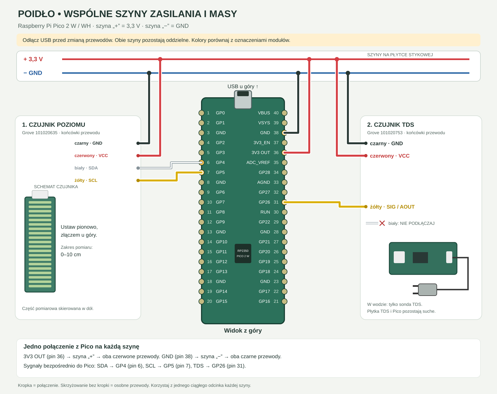

# Bioglow — poidełko dla ptaków

Szkolny projekt z Raspberry Pi Pico 2 W / WH i programem w MicroPythonie. Czujniki mierzą poziom wody oraz orientacyjny TDS. Urządzenie udostępnia lokalny panel i wysyła pomiary do Adafruit IO; publiczna strona jest hostowana przez GitHub Pages.

**Strona:** https://gmrogalski.github.io/poidelko/

```text
Czujniki → Pico → Wi-Fi z internetem → Adafruit IO → strona GitHub Pages
```

Pico wysyła pomiar co 60 sekund. Strona sprawdza dane co 15 sekund i pokazuje czas pomiaru. Po 3 minutach bez nowych danych oznacza wartości jako nieaktualne. Komputer nie musi być włączony.

## Sprzęt i połączenia

- Raspberry Pi Pico 2 W z wlutowanymi złączami;
- Grove Water Level Sensor 10 cm, Seeed 101020635, I²C;
- Grove TDS Sensor, Seeed 101020753, sygnał analogowy;
- płytka stykowa, przewody Grove–Dupont, zasilanie USB.



| Połączenie | Pico | Fizyczny pin |
| --- | --- | --- |
| Wspólna szyna „+”, oba czerwone przewody | 3V3 OUT | 36 |
| Wspólna szyna „−”, oba czarne przewody | GND | 38 |
| Poziom: biały SDA | GP4 | 6 |
| Poziom: żółty SCL | GP5 | 7 |
| TDS: żółty sygnał | GP26 / ADC0 | 31 |
| TDS: biały NC | niepodłączony | — |

Przewody zmieniaj przy odłączonym USB. Pico, płytka stykowa i elektronika TDS pozostają suche. Oznaczenia na modułach mają pierwszeństwo przed kolorami.

## Uruchomienie

1. Wgraj [MicroPythona dla Pico 2 W](https://micropython.org/download/RPI_PICO2_W/).
2. Skopiuj `config.example.py` do `config.py`. Ustaw `WIFI_MODE = "STA"` oraz nazwę i hasło sieci 2,4 GHz.
3. Skopiuj `cloud_secrets.example.py` do `cloud_secrets.py`. Wpisz dane swojego konta Adafruit IO.
4. W Adafruit IO utwórz publiczny kanał `poidelko`. Pole danych zawiera jeden dokument JSON z odczytami. Publiczne uprawnienia obejmują wyłącznie odczyt.
5. W `docs/config.json` ustaw publiczną nazwę użytkownika i klucz kanału. Nigdy nie wpisuj tam klucza API.
6. Zainstaluj narzędzie i wgraj firmware:

```sh
python3 -m venv .venv
source .venv/bin/activate
python -m pip install -r requirements-dev.txt
python tools/deploy_pico.py
```

Szczegóły pracy w VS Code: [INSTALACJA.md](INSTALACJA.md).

`config.py` i `cloud_secrets.py` są pomijane przez Git. Hasła trafiają tylko na własne Pico; panel WWW nie udostępnia tych plików. Klucz Adafruit IO jest wysyłany w nagłówku HTTPS. Program weryfikuje certyfikat CA i nazwę hosta, a zegar ustawia przez NTP, jeśli jest potrzebny do weryfikacji TLS. `adafruit-ca.der` to publiczny certyfikat zaufanego urzędu ze zweryfikowanego łańcucha Adafruit IO, pobrany 6 listopada 2026. Przy zmianie łańcucha zaufania wymaga aktualizacji.

## Własna sieć Pico

`WIFI_MODE = "AP"` uruchamia własną sieć z nazwą i hasłem określonymi w `config.py`. Panel jest wtedy dostępny pod adresem http://192.168.4.1/.

W trybie samego AP Pico nie ma dostępu do internetu i nie wysyła nowych pomiarów do publicznej strony. Do zdalnego podglądu potrzebuje routera lub hotspotu z internetem w trybie STA.

## Pliki

- `main.py`, `app.py` — start, pomiary i obsługa sieci;
- `sensors.py` — sterowniki obu czujników;
- `cloud.py`, `adafruit-ca.der` — publikacja przez zweryfikowane HTTPS;
- `webserver.py`, `dashboard.html` — lokalny panel, odświeżanie co 2 s;
- `docs/` — strona GitHub Pages;
- `tools/deploy_pico.py` — wgrywanie przez USB;
- `01_dioda.py`, `02_odczyty.py`, `04_diagnostyka.py` — próby sprzętowe.

GitHub Pages: Settings → Pages → Deploy from a branch → `main` → `/docs`.

## Interpretacja wyników

Czujnik poziomu obejmuje 100 mm z krokiem 5 mm. Procent zanurzenia czujnika nie oznacza procentu objętości zbiornika; dla zbiornika o zmiennym kształcie potrzebna jest kalibracja objętości.

TDS jest przybliżeniem ilości rozpuszczonych substancji. Nie potwierdza bezpieczeństwa wody i nie wykrywa bakterii. Program nie ma pomiaru temperatury wody ani wykonanej kalibracji względem wzorca. Sonda musi być zanurzona w spokojnej wodzie. Poidełko wymaga regularnego mycia i wymiany wody niezależnie od wskazań.

## Dokumentacja

- [Grove Water Level Sensor](https://wiki.seeedstudio.com/Grove-Water-Level-Sensor/)
- [Grove TDS Sensor](https://wiki.seeedstudio.com/Grove-TDS-Sensor/)
- [MicroPython RP2](https://docs.micropython.org/en/latest/rp2/quickref.html)
- [Adafruit IO API](https://io.adafruit.com/api/docs/http.html)
